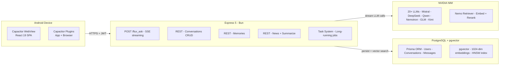

<div align="center">
  <picture>
    <source media="(prefers-color-scheme: dark)" srcset="frontend/src/logo.svg">
    
  </picture>
  <br>
  <h1 style="margin: 0; font-size: 3em; font-weight: 400; letter-spacing: -1px;">Flux for Android</h1>
  <p style="font-size: 1.15em; color: #6c6a64; margin-top: 4px;">
    <em>Multi-model AI chat · Document generation · Web search · Long-term memory</em>
  </p>
</div>

<p align="center">
  <a href="https://github.com/shounakjoshi88-a11y/Flux/releases"></a>
  <a href="#features"></a>
  <a href="#build-yourself"></a>
  <a href="#architecture"></a>
</p>

<p align="center">
  
  
  
  
  
  
  
  
</p>

---

<h2 id="features"> Features</h2>

<details open>
<summary><strong> Multi-Model Chat</strong></summary>
<br>
Switch between 20+ models from a unified chat interface:

| Category | Models |
|----------|--------|
| **General Purpose** | Mistral Large 3 675B, GLM 5.1, Kimi K2.6, Nemotron 3 Ultra 550B, Mistral Medium 3.5 128B, DeepSeek V4 Flash/Pro, Qwen 3.5 397B, MiniMax M2.7/M3, Sarvam-M, Stockmark 2 100B, and more |
| **Vision** | Nemotron Nano 12B V2 VL — handle image attachments |
| **Coding** | Specialized models for code generation and review |

Each model streams responses in real-time via SSE, with visible thought process, source attribution, and follow-up suggestions.
</details>

<details>
<summary><strong> Document Generation</strong></summary>
<br>
Generate professional documents from plain English descriptions:

| Format | Capabilities |
|--------|-------------|
| **PDF** | Corporate (navy/blue), Minimal (clean white), Creative (teal/indigo), Report (academic) with custom fonts including CJK support |
| **DOCX** | Professional headings & body sections |
| **PPTX** | Dark-theme slide decks with title, bullet, comparison, and section layouts |
| **XLSX / CSV / TSV** | Formatted spreadsheets and delimited data |
| **Markdown / JSON / SQL / HTML** | Structured text documents |

Documents are built server-side by LLM-driven generation with format-specific skill prompts.
</details>

<details>
<summary><strong> Agentic Tool System</strong></summary>
<br>
The AI autonomously orchestrates tool calls to answer your queries:

- **Web Search** — Real-time search via Tavily with full-page content extraction, query relevance filtering, anti-hallucination guards
- **Document Generation** — Create files in 10 formats from natural language
- **Weather Lookup** — Current conditions via OpenWeatherMap + Open-Meteo
- **Image Generation** — Produce images via local Bonsai inference service

Up to 10 autonomous reasoning steps per query, with search loop guard, casual chat detection, and forced answer fallback.
</details>

<details>
<summary><strong> Long-Term Memory</strong></summary>
<br>
Flux remembers what matters:

- **Automatic Extraction** — LLM extracts key facts from conversations in the background
- **Vector Storage** — 1024-dimensional embeddings via BGE-M3 (local, Xenova Transformers)
- **Similarity Search** — pgvector operator for fast semantic retrieval
- **Importance Scoring** — Memories ranked by relevance; low-importance junk gets pruned
- **Deduplication** — Near-duplicate detection using embedding distance thresholds
- **Context Injection** — Relevant memories automatically injected into system prompts
</details>

<details>
<summary><strong> Voice I/O</strong></summary>
<br>

- **Speech-to-Text** — NVIDIA ASR (Parakeet 1.1B multilingual) for transcribing voice input
- **Text-to-Speech** — Microsoft Edge TTS with 100+ voices across languages
- **Browser TTS** — Read-aloud button on messages via Web Speech API
</details>

<details>
<summary><strong> News Aggregation</strong></summary>
<br>
Multi-source news reader built right in:

- **Sources** — BBC, NPR, Reuters, CNN, Ars Technica, Wired, HackerNews, and more
- **Categories** — All, World, Tech, Business, Science, Politics
- **Caching** — Server-side RSS caching with configurable TTL
</details>

<details>
<summary><strong> Conversation Management</strong></summary>
<br>

- **Searchable History** — Full-text search across all conversations with PostgreSQL FTS
- **Auto-Titling** — Conversations automatically renamed via dedicated small LLM
- **Time Grouping** — Sidebar groups conversations by Today, Yesterday, This Week, etc.
- **Undo Delete** — Deleted conversations can be restored via toast notification
- **Artifacts Gallery** — Browse every generated file across all conversations in one place
</details>

<details>
<summary><strong> Mobile-Optimized UX</strong></summary>
<br>

- **Touch-friendly** — All interactions designed for touch input
- **Safe-area-aware** — Respects Android notch and gesture bars
- **Splash Screen** — Branded launch screen with configurable duration
- **Pull-to-refresh** — Native-feeling conversation refresh
- **Adaptive Layout** — Responsive design that works on phones and tablets
- **Share Sheet** — Android native share integration for conversations
</details>

---

<h2 id="build-yourself"> Build the APK Yourself</h2>

### Prerequisites

- [Bun](https://bun.sh) v1.2+
- [Android Studio](https://developer.android.com/studio) (for the Android SDK)
- Java 17+ (bundled with Android Studio)
- The backend runs on Azure — you don't need to run it locally unless you're developing

### Quick Build

```bash
# 1. Install frontend dependencies
cd frontend && bun install

# 2. Build the web app
bun run build

# 3. Sync web assets to the Android project
npx cap sync android

# 4. Build the debug APK
cd android && ./gradlew assembleDebug

# APK location:
# frontend/android/app/build/outputs/apk/debug/Flux-debug.apk
```

### One-Step Build Script

```bash
cd frontend
bun install && bun run build && npx cap sync android && cd android && ./gradlew assembleDebug
```

### Building a Release APK

For a production-ready signed APK:

1. Generate a keystore:
```bash
keytool -genkey -v -keystore release.keystore -alias flux -keyalg RSA -keysize 2048 -validity 10000
```

2. Place it at `frontend/android/app/flux.keystore`

3. Build the release APK:
```bash
cd frontend/android && ./gradlew assembleRelease
```

---

<h2 id="architecture"> Architecture</h2>



**Request flow:**
1. User types a message in the Android WebView
2. Frontend sends `POST /flux_ask` to the remote backend
3. The LLM responds with streaming text + tool calls
4. Server executes tools and streams results back
5. Final answer renders with sources, follow-ups, and artifacts

---

<h2 id="project-structure"> Project Structure</h2>

```
flux-android/
├── frontend/
│   ├── src/                        # React 19 SPA
│   │   ├── App.tsx                 # Router
│   │   ├── pages/Dashboard.tsx     # Main chat UI
│   │   ├── pages/Auth.tsx          # OAuth login
│   │   ├── hooks/useChat.ts        # SSE stream handler
│   │   ├── components/             # 40+ UI components
│   │   └── lib/                    # Utilities, config
│   ├── android/                    # Android project (Gradle)
│   │   ├── app/
│   │   │   ├── src/main/           # Manifest, Java, resources
│   │   │   └── build.gradle
│   │   ├── gradlew
│   │   └── build.gradle
│   ├── capacitor.config.ts         # Capacitor configuration
│   ├── build.ts                    # Bun build script
│   └── package.json
│
├── backend/                        # Express 5 API (runs on Azure)
│   ├── index.ts                    # Server entry — all routes
│   ├── model-health.ts             # Model fallback health tracking
│   ├── task-routes.ts              # Long-running task API
│   ├── task-detector.ts            # Task intent classification
│   ├── task-loop.ts                # Task execution loop
│   ├── memory.ts                   # Vector memory extraction
│   ├── tool-registry.ts            # Central tool registry
│   ├── prompt.ts                   # System prompts
│   ├── nim-client.ts               # NVIDIA NIM client
│   ├── agent-protocol/             # WebSocket agent protocol
│   ├── orchestrator/               # Agentic loop (plan-execute-verify)
│   └── prisma/                     # Schema + migrations
│
├── api/                            # Vercel serverless wrapper
├── shared/                         # Shared types
├── Flux-Android.apk                # Pre-built debug APK
└── README.md
```

---

<h2 id="tech-stack"> Tech Stack</h2>

| Layer | Technology | Purpose |
|-------|-----------|---------|
| **Mobile Wrapper** | [Capacitor 8](https://capacitorjs.com) | Native Android WebView + plugins |
| **Frontend** | React 19 + TypeScript | SPA with hooks, component system |
| **Styling** | Tailwind CSS + framer-motion | Utility CSS, spring animations |
| **Runtime** | [Bun](https://bun.sh) | JS/TS bundler, dev server |
| **Backend** | Express 5 + TypeScript | REST API, SSE streaming |
| **Database** | PostgreSQL + Prisma + pgvector | Relational data, ORM, vector embeddings |
| **Auth** | Supabase | OAuth (Google, GitHub), JWT sessions |
| **AI** | NVIDIA NIM | 20+ LLMs via OpenAI-compatible API |
| **Search** | Tavily | Real-time web search API |
| **Voice** | NVIDIA ASR + Edge TTS + Web Speech API | Speech recognition + synthesis |
| **Embeddings** | Xenova Transformers | BGE-M3: local 1024-dim embeddings |

---

## Environment Variables

The Android app connects to the production backend automatically. For local development, create `frontend/.env`:

```env
# The backend this app connects to
BACKEND_URL=http://localhost:3001
```

The backend requires its own `.env` in `backend/` — see the [main Flux README](https://github.com/shounakjoshi88-a11y/Flux) for the full list.

---

## Troubleshooting

### APK Won't Install
- Enable "Install from unknown sources" in Android Settings
- You may need to uninstall any previous version first
- Debug APKs are self-signed — this is normal for development builds

### Android Build Fails
```bash
# Check Java version (requires 17+)
java -version

# Clean and rebuild
cd frontend/android
./gradlew clean
./gradlew assembleDebug

# If Gradle issues, delete cache
rm -rf .gradle
```

### Web Build Fails
```bash
cd frontend
rm -rf node_modules dist bun.lock
bun install
bun run build
```

### Backend Connection Issues
- The APK connects to the hosted backend by default
- Check your internet connection
- Verify the backend status at the health endpoint

---

## Contributing

1. Fork the repository
2. Create a feature branch (`git checkout -b feature/amazing-feature`)
3. Commit your changes
4. Push to your branch
5. Open a Pull Request

---

<p align="center">
  <sub> Built with Bun · React 19 · Capacitor 8 · PostgreSQL · NVIDIA NIM · Supabase</sub>
  <br>
  <sub> Flux for Android — open source, contributions welcome</sub>
</p>
